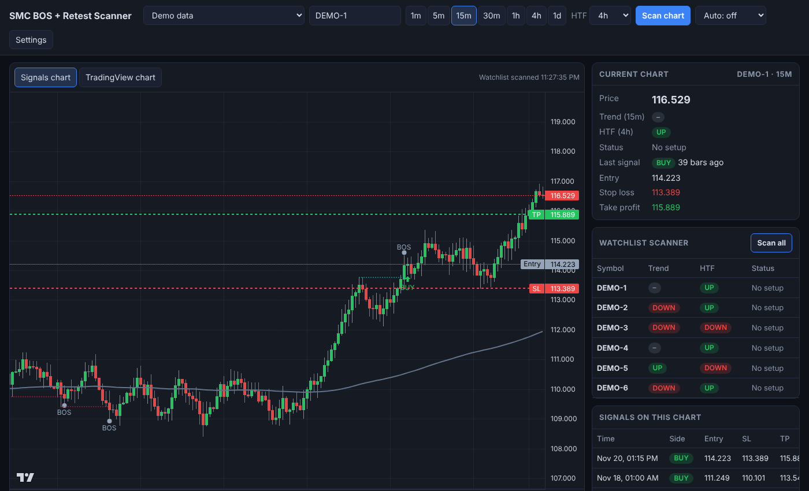

# SMC BOS + Retest Scanner (web app)

A single-page app. It loads live candles, runs the SMC trend + break of structure + retest logic in the browser, and draws the signals on a TradingView Lightweight Charts chart. A second tab shows the official TradingView chart for the same symbol.

## Run it
- **Locally:** open `index.html` in Chrome or Edge. You can also run `npx serve webapp` and open the URL it prints.
- **Online:** turn on GitHub Pages for this repo and use `/webapp/index.html`.

## Live data sources
| Market | Source | Key needed? |
|---|---|---|
| Crypto (BTCUSDT, ETHUSDT…) | Binance public market data | No |
| Forex, gold, indices, stocks (EUR/USD, XAU/USD…) | Twelve Data | Free API key from twelvedata.com. Paste it in **Settings**. The free plan allows 8 requests/min, so the watchlist scans slowly. |
| Demo | Generated candles | No |

## Use
1. Pick a source, symbol, timeframe and HTF, then press **Scan chart**.
2. **Scan all** checks your watchlist. Click a row to load that symbol on the chart.
3. Set **Auto** to re-scan every 1/5/15 min. Enable notifications in Settings to get a popup and a sound on each new signal. The tab has to stay open.
4. All strategy settings (swing length, trend filter, retest tolerance, SL buffer, R:R) are under **Settings**.

## Backtest
Open the **Backtest** tab and pick *This chart* or *Whole watchlist*. Choose 1,000–5,000 candles and set costs per trade (in R) and risk per trade, then press **Run backtest**.
The backtest replays the same rules over past closed candles and checks which was hit first, SL or TP (SL wins ties on the same candle). It reports trades, win rate, profit factor, net R and %, max drawdown, the longest losing run, an equity curve, a per-pair breakdown and every trade.
Demo data is synthetic and very trendy, so use Binance or Twelve Data for real results. Checked for look-ahead bias: on pure random-walk data the strategy wins about 31% at 1:2 (break-even is 33%).
